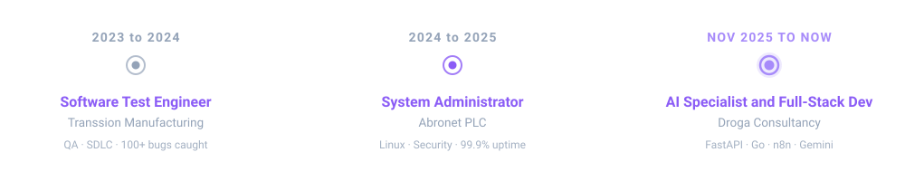
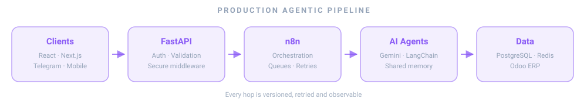
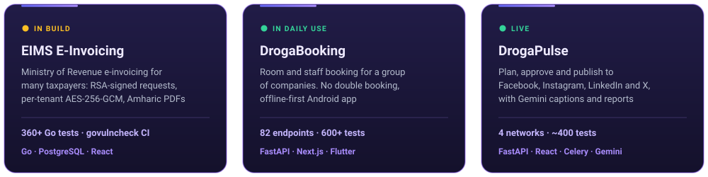

<div align="center">



</div>

<br/>

<div align="center">

[](https://git.io/typing-svg)

</div>

<br/>

<div align="center">

[](https://robel-portfolio-ten.vercel.app/)
&nbsp;
[](https://robel-portfolio-ten.vercel.app/Robel_Shemeles_CV.pdf)
&nbsp;
[](https://www.linkedin.com/in/robel-shimeles-154b5a3b8)
&nbsp;
[](mailto:robelshemeles4@gmail.com)
&nbsp;
[](https://pypi.org/project/habesha-names/)

</div>

<div align="center">

</div>

## 🧠 Who Am I?

<table>
<tr>
<td width="55%">

I'm an **AI Specialist and Full-Stack Developer** at **Droga Consultancy** with 3+ years of experience, and I build things that *actually ship*.

My career started in the trenches: **software testing** and **system administration**. That foundation gave me an instinct most developers pick up late, if at all: a feel for *uptime, security and tests*.

Today I build and run production systems end to end: **FastAPI and Go** backends, **Next.js** web apps, offline-first **Flutter** apps, and **AI assistants on n8n and Gemini** for pharmacy, HR, ERP and suppliers, all in daily use across a group of companies. The AI only ever runs approved, permission-scoped queries, never its own SQL.

Right now I'm building **EIMS**, a multi-tenant Go platform for Ethiopia's Ministry of Revenue e-invoicing API.

</td>
<td width="45%" align="center">

```
┌─────────────────────────────┐
│  💼  Right now              │
│      AI Specialist @        │
│      Droga Consultancy      │
│                             │
│  🧾  Building               │
│      EIMS e-invoicing       │
│      platform in Go         │
│                             │
│  🤖  Specialty              │
│      Permission-scoped      │
│      AI agents on n8n       │
│                             │
│  📦  Latest ship            │
│      habesha-names 0.2.0    │
│      live on PyPI           │
│                             │
│  📍  Based in               │
│      Addis Ababa, Ethiopia  │
└─────────────────────────────┘
```

</td>
</tr>
</table>

<div align="center">

</div>

## 💼 Where I've Shipped

<div align="center">



</div>

<br/>

<details open>
<summary>&nbsp;<b>🟣 AI Specialist and Full-Stack Developer, Droga Consultancy</b> &nbsp;·&nbsp; <code>Nov 2025 to present</code></summary>
<br/>

- ▹ **DrogaBooking:** room and staff booking for the group companies, built end to end. FastAPI and PostgreSQL backend (82 endpoints, 600+ tests, database rules that make double booking impossible), Next.js web app, offline-first Flutter Android app, per-company billing.
- ▹ **DrogaPulse:** social media SaaS that schedules and publishes to Facebook, Instagram, LinkedIn and X, with Gemini captions and reports, a Celery/Redis queue and a Capacitor Android app. Live since spring 2026.
- ▹ **EIMS, in development:** multi-tenant Go e-invoicing platform for the Ministry of Revenue. Byte-exact SHA512withRSA request signing, per-tenant AES-256-GCM encryption, RBAC, TOTP, a tamper-evident audit log and Amharic PDF invoices. 360+ Go tests.
- ▹ **AI assistants on n8n and Gemini, in daily use:** a pharmacy chatbot that reads prescription photos, an HR performance assistant with role-based access, an Odoo ERP assistant, a supplier portal assistant and Amharic voice registration.
- ▹ **Data and Go APIs:** a market intelligence dashboard and AI chatbot on regulator import data, and the Go API (chi, pgx, goose, JWT) of a group executive dashboard.
- ▹ Run the production servers (Docker, Traefik, nginx, Cloudflare, CI/CD, backups) and the **SEO and GEO** for [drogaconsulting.com](https://drogaconsulting.com).

`FastAPI` &nbsp;`Go` &nbsp;`PostgreSQL` &nbsp;`Next.js` &nbsp;`Flutter` &nbsp;`n8n` &nbsp;`Gemini` &nbsp;`Docker` &nbsp;`SEO/GEO`

</details>

<details>
<summary>&nbsp;<b>🔵 System Administrator, Abronet PLC</b> &nbsp;·&nbsp; <code>Jan 2024 to Sep 2025</code></summary>
<br/>

- ▹ Kept the company's financial web platforms at **99.9% uptime**.
- ▹ Hardened server security and access control.
- ▹ Scripted away routine maintenance: less overhead, fewer errors.

`Linux` &nbsp;`Scripting` &nbsp;`Security`

</details>

<details>
<summary>&nbsp;<b>⚪ Software Test Engineer, Transsion Manufacturing</b> &nbsp;·&nbsp; <code>Jan 2023 to Jan 2024</code></summary>
<br/>

- ▹ **100+ pre-release bugs** caught across mobile and internal systems.
- ▹ Product quality up **15%** through cross-functional SDLC work.

`QA` &nbsp;`SDLC`

</details>

<div align="center">

</div>

## 🤖 How I Build

<div align="center">



</div>

<br/>

```python
# In production today 🚀
production = {
    "booking":      "DrogaBooking: 82 endpoints, 600+ tests, offline-first Flutter app",
    "saas":         "DrogaPulse: one calendar for Facebook, Instagram, LinkedIn and X",
    "agentic_ai":   "26-node pharmacy chatbot, 5 Gemini agents with shared memory",
    "rbac_agents":  "HR assistant where each role sees only what it is allowed to",
    "erp_copilots": "Odoo assistant answering natural language via 8 live SQL tools",
    "voice_ai":     "Spoken Amharic in, structured records out",
    "middleware":   "5+ secure FastAPI backends bridging frontends to n8n workflows",
    "open_source":  "habesha-names on PyPI, zero dependencies, 1,700+ test name pairs",
}

building = "EIMS: Go e-invoicing for Ethiopia's Ministry of Revenue, 360+ tests"
rule     = "The AI runs approved, permission-scoped queries. Never its own SQL."
```

<div align="center">

</div>

## 📦 Open Source

<table>
<tr>
<td>

### [`habesha-names`](https://pypi.org/project/habesha-names/) &nbsp;[](https://pypi.org/project/habesha-names/) [](https://pypi.org/project/habesha-names/)

Ethiopian and Eritrean **name intelligence** for Python. Ge'ez to Latin transliteration and back, spelling-variant generation, patronymic-aware parsing and sound-alike matching, built for **KYC/AML, remittance and HR** systems that keep failing on Habesha names.

**Zero dependencies · Fully typed · Tested on 1,700+ name pairs · ~50K matches per second · Native-speaker curated**

```bash
pip install habesha-names
```

[**PyPI ↗**](https://pypi.org/project/habesha-names/) &nbsp;·&nbsp; [**Source ↗**](https://github.com/Robel231/habesha-names)

</td>
</tr>
</table>

<div align="center">

</div>

## 🏗 Products and Platforms

<div align="center">

<a href="https://robel-portfolio-ten.vercel.app/#projects"></a>

[**DrogaPulse live ↗**](https://drogapulse.drogatech.com) &nbsp;·&nbsp; EIMS and DrogaBooking run behind company logins, demo on request

</div>

<br/>

| More builds | What it is | Stack | Link |
|:--------|:-----------|:------|:----:|
| **DCS Wellness** | AI health platform with streaming diagnostics, Ethiopian food image recognition, 4 languages | `FastAPI` `React` `RN Expo` `Gemini` `Docker` | [Live ↗](https://yene-jegna.drogapharma.rw) |
| **Wuten** | Finance app that reads Ethiopian bank and telebirr SMS to log spending: budgets, savings goals, equb, debts and an AI assistant, ~430 tests | `Flutter` `Dart` `SQLite` | Demo on request |
| **Executive Dashboard API** | Go backend for a group executive dashboard: approvals, tasks, risks, KPIs and an audit trail. 68 routes, 351 end-to-end checks | `Go` `chi` `pgx` `goose` `Next.js 15` | In development |
| **CardFlow** | Multi-tenant ID card SaaS: drag-and-drop template editor, automatic photo background removal, JWT/RBAC, tenant billing, card history | `FastAPI` `Next.js` `PostgreSQL` `Docker` | [Live ↗](https://cards.drogatech.com) |
| **AI Cover Letter Generator** | Tailored cover letters for Ethiopian job seekers | `React` `FastAPI` `OpenAI` `Supabase` | [Live ↗](https://ai-cover-letter-ethiopia.vercel.app/) · [Code](https://github.com/Robel231/ai-cover-letter-ethiopia) |
| **Merkato Math** | Browser math game: 100 procedurally generated levels, shared Redis leaderboard | `Next.js` `Vercel Redis` | [Live ↗](https://merkato-math.vercel.app/) |

## 🧩 AI Systems in Production

| System | What it does | Stack |
|:-------|:-------------|:------|
| **AI Pharmacy Assistant** | 26 nodes, 5 specialist Gemini agents with shared memory. Reads prescription photos, guides patients, flags stock-outs | `n8n` `Gemini` `Vision` |
| **HR Performance Assistant** | Employees, managers and HR each see only what their role allows. FastAPI middleware checks a signed JWT, and the agent runs only permission-scoped, read-only queries | `n8n` `FastAPI` `JWT` `RBAC` |
| **Odoo ERP AI Assistant** | Ask the ERP anything. Natural language over 8 live PostgreSQL tools | `n8n` `LangChain` `PostgreSQL` |
| **Market Intelligence Chatbot** | Who imports what, and at what price. Python ETL over regulator import-permit data, with a FastAPI and React dashboard | `Python` `PostgreSQL` `FastAPI` `React` |
| **Amharic Voice Registration** | Voice AI for a language most models overlook | `Gemini 2.5 Flash` `n8n` `Multimodal` |

> 🔭 **Building now:** EIMS, a Go e-invoicing platform going through Ministry of Revenue accreditation. A Go SDK, a CLI and a multi-tenant REST service with a console in English and Amharic, 360+ Go tests and govulncheck in CI.

<div align="center">

</div>

## 🛠 Tech Arsenal

<div align="center">


</div>

<br/>

| Area | What I reach for |
|:--|:--|
| **🤖 AI and agents** | Gemini · OpenAI · Claude · LangChain · RAG · n8n orchestration · Telegram bots · Multimodal and Amharic voice pipelines |
| **🌐 Frontend and mobile** | React · Next.js · TypeScript · Tailwind · Flutter (Dart) · React Native (Expo) · Capacitor |
| **⚙️ Backend** | Python · FastAPI · Go (chi, pgx) · Django · Flask · Node.js · Celery · REST and webhook design |
| **🗄 Data** | PostgreSQL · MySQL · Redis · Supabase · Firebase · SQLite · SQLAlchemy and Alembic · goose |
| **🔐 Security** | JWT/RBAC · TOTP · SHA512withRSA request signing · AES-256-GCM per-tenant encryption · tamper-evident audit logs · govulncheck |
| **☁️ Infra** | Docker Compose · nginx · Traefik · Cloudflare · Linux (Fedora, Ubuntu, Kali) · GitHub Actions CI/CD · Vercel · Render · Contabo VPS · backups |
| **🔍 Craft** | pytest · Vitest · QA instincts from a testing background · Technical SEO and GEO · Systems thinking · Technical writing and team enablement |

<div align="center">

</div>

## 📊 GitHub at a Glance

<div align="center">

<picture>
  <source media="(prefers-color-scheme: dark)" srcset="https://github-readme-stats.vercel.app/api?username=Robel231&show_icons=true&hide_border=true&count_private=true&include_all_commits=true&cache_seconds=86400&theme=midnight-purple&bg_color=0d1117&title_color=a78bfa&icon_color=a78bfa&text_color=c9d1d9"/>
  <source media="(prefers-color-scheme: light)" srcset="https://github-readme-stats.vercel.app/api?username=Robel231&show_icons=true&hide_border=true&count_private=true&include_all_commits=true&cache_seconds=86400&bg_color=ffffff&title_color=6d28d9&icon_color=7c3aed&text_color=24292f"/>
  
</picture>
&nbsp;
<picture>
  <source media="(prefers-color-scheme: dark)" srcset="https://github-readme-stats.vercel.app/api/top-langs/?username=Robel231&layout=compact&hide_border=true&langs_count=8&cache_seconds=86400&theme=midnight-purple&bg_color=0d1117&title_color=a78bfa&text_color=c9d1d9"/>
  <source media="(prefers-color-scheme: light)" srcset="https://github-readme-stats.vercel.app/api/top-langs/?username=Robel231&layout=compact&hide_border=true&langs_count=8&cache_seconds=86400&bg_color=ffffff&title_color=6d28d9&text_color=24292f"/>
  
</picture>

</div>

<!--
  Heads up: the public github-readme-stats instance is best effort and gets
  rate limited, so these cards can render as broken images at busy times.
  If that keeps happening, either self host the service or generate the
  cards inside this repo with .github/workflows/metrics.yml and point the
  images at the committed SVG instead.
-->

<br/>

<div align="center">

<picture>
  <source media="(prefers-color-scheme: dark)" srcset="https://raw.githubusercontent.com/Robel231/Robel231/output/github-contribution-grid-snake-dark.svg">
  <source media="(prefers-color-scheme: light)" srcset="https://raw.githubusercontent.com/Robel231/Robel231/output/github-contribution-grid-snake.svg">
  
</picture>

</div>

<div align="center">

</div>

## 🌍 Building for Ethiopia and Beyond

- 🗣️ **Amharic-first:** voice AI, Amharic PDF invoices and bilingual consoles, for a language most models overlook
- 🧾 **Local rails:** Ministry of Revenue e-invoicing, bank and telebirr SMS, equb and the Ethiopian calendar
- 📱 **Mobile-first and offline-first** apps for bandwidth-aware environments
- 🤝 **Local context:** solutions that land culturally as well as functionally
- 🌐 **Global standards:** every project built to international engineering quality bars

<div align="center">

</div>

## 💬 Let's Build Something

I'm open to:

- 🚀 **Full-time roles**, remote friendly, ambitious product teams
- 🤝 **Freelance work** on AI agents, automation and full-stack builds
- 💡 **Consulting** on n8n workflows, FastAPI and Go architecture, Gemini and OpenAI integration
- 🌱 **Open-source collaboration** on tools that help the Ethiopian developer community

<br/>

<div align="center">

[](https://robel-portfolio-ten.vercel.app/)
&nbsp;
[](https://robel-portfolio-ten.vercel.app/Robel_Shemeles_CV.pdf)
&nbsp;
[](https://www.linkedin.com/in/robel-shimeles-154b5a3b8)
&nbsp;
[](mailto:robelshemeles4@gmail.com)

</div>

<br/>

<div align="center">


<br/>


&nbsp;


</div>
